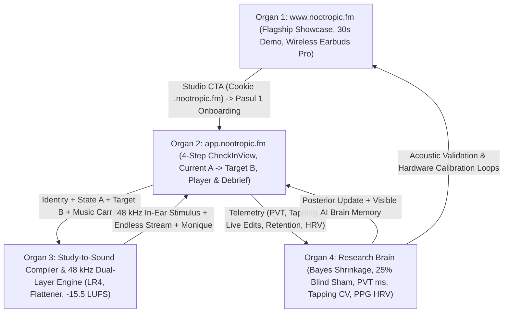

# `nootropic.fm` & `NOOTROPIC FM SOUND SYSTEMS` — Structura Ecosistemului și Cei 10 Piloni ai Rețetei Secrete

> **Document Constituțional Canonic (Sursa Unică de Adevăr Tehnică, Științifică, Acustică și Hardware)**
> Aplicabil întregului ecosistem `nootropic.fm` (`www.nootropic.fm`, `app.nootropic.fm`, `Study-to-Sound Compiler`, `Research Brain` și linia hardware `NOOTROPIC FM SOUND SYSTEMS`).

---

## 1. Teza Fondatoare, North Star & ADN-ul Inconfundabil (`Visual, Acoustic & Hardware DNA`)

### 1.1 Teza Fondatorului (*Continentul Neexplorat al Minții Umane*)
Felul în care creierul uman reacționează la stimulare acustică de precizie rămâne, în mare parte, un teritoriu neexplorat. Industriei actuale de *focus music* îi lipsește bucla științifică: difuzează playlist-uri statice, ignoră starea nervoasă reală cu care intră omul și nu măsoară niciodată dacă semnalul a produs un efect real față de placebo.

**`nootropic.fm` nu este o bibliotecă de playlist-uri ambientale — este primul AI de Tuning Neuronal în Buclă Închisă (`Closed-Loop Neural Tuning AI`):**
1. **Știe cine este ascultătorul** (identitate anonimizată, sensibilitate la zgomot, context de lucru, telemetrie istorică).
2. **Citește cum se simte în acest moment** (`Starea A` pe busola bidimensională `Energy × Clarity`).
3. **Citește unde vrea să ajungă** (`Starea B` obiectiv cognitiv/autonom, durată și purtătoare muzicală).
4. **Compilează studii neuroștiințifice umane** (`PubMed / OpenAlex` — doar stimulare auditivă umană cu `DOI / PMID`) în semnal acustic matematic la `48 kHz`.
5. **Măsoară reacția reală a sistemului nervos** (`20-trial PVT` în milisecunde `1/RT`, tapping `CV`, ajustări live, retenție pe sesiune, control orb `25% Aperiodic Sham` și telemetrie optică `PPG · HRV`).
6. **Învață sesiune după sesiune** cum să tuneze fiecare minte umană la vârful ei de performanță, construind o bază de date cauzală unică în lume.

### 1.2 North Star Strategic & Financiar
- **Categorie proprietară:** *Closed-Loop Neural Acoustic Intelligence* (Path B — ecosistem integrat software `48 kHz` + telemetrie comportamentală/biometrică + hardware `In-Ear` calibrat în fază).
- **Țintă economică (Path B vs. Path A pur software):** Trecerea de la plafonul aplicațiilor pur B2C (`\$2M–\$30M ARR`, `LTV/CAC ~1.34x`) la ecosistemul în buclă închisă (`\$100M+` Pure ARR, marjă brută consolidată `~80.2%`, auto-lichidarea CAC-ului în Ziua 1 prin pachete hardware + Pro, `LTV/CAC > 3.20x`, traiectorie evaluată în scenariul de bază la `\$1B+`).

### 1.3 ADN Vizual & Ergonomie Circadiană Non-Negociabile
Orice interfață de pe `www.nootropic.fm` și `app.nootropic.fm` respectă strict două moduri calibrate psihofiziologic:
- **Daylight Architectural Slate (`06:00 – 20:00` / Mod Zi):**
  - Suprafețe reci arhitecturale: `#E2E8F0` / `#FFFFFF` / `#F8FAFC` / `#E6ECF2`.
  - Cerneală cu contrast ridicat: `#0F172A`.
  - Accente calibrate WCAG: Cobalt `#1E40AF` și Emerald `#047857`.
  - **Interdicție absolută:** **ZERO** nuanțe de galben, chihlimbar, auriu cald sau crem în `Daylight Mode`.
- **Nocturnal Silk (`20:00 – 06:00` / Mod Noapte):**
  - Fundaluri profunde cu strălucire minimă a ecranului: `#07090E` / `#0D111A`.
  - Accente calibrate: Cyan `#38BDF8` și Emerald `#34D399`.
  - **Cuplaj acustic circadian automat:** după ora `20:00` (sau la comutarea în modul nocturn), motorul DSP activează un *roll-off* blând peste `3.2 kHz` pentru reducerea oboselii auditive și protecția tranziției spre somn.

### 1.4 ADN Hardware Industrial (*Orbital Phase-Ring — Wireless First*)
Linia hardware **`NOOTROPIC FM SOUND SYSTEMS`** are o siluetă recognoscibilă instantaneu, care nu există ca limbaj biometric pe piața de masă:
- **Limbajul *Orbital Phase-Ring*:** Arhitectură *stemless* (fără codiță), carcasă frezată CNC în 5 axe din aluminiu obsidian `6063`, nucleu frontal din safir întunecat cu inele concentrice gravate (`((•))`), halou micro-șanfrenat de `0.3 mm` în `#34D399` și gravură laser crisp **`nootropic.fm`**.
- **Regula Absolută *Wireless-First*:**
  1. **Prim-plan (#1 Spotlight — Flagship):** **`NootropicFM Earbuds Pro` (`\$249`)** — **100% fără fire**, transport lossless / `LC3`, senzor optic **`PPG · HRV`** + termistor NTC integrat direct în fereastra de safir din concha urechii, cu carcasă de încărcare din aluminiu obsidian periat gravată `nootropic.fm`.
  2. **Obiect Arhitectural de Birou & Noptieră (#2):** **`NootropicFM Sound System 01` (`\$549`)** — monolit *nearfield* cu anulare activă de crosstalk (`XTC`), radar `mmWave` / ToF fără contact și matrice LED circadiană `1800K – 480nm`.
  3. **Opțiune Secundară de Studio (#3, niciodată în prim-plan):** **`NootropicFM Earbuds 01` (`\$129`)** — ediție cu cablu USB-C ecranat (`24-bit/48 kHz DAC`, `0.0°` eroare de fază) pentru birouri/laboratoare sau primii utilizatori desktop. **Căștile cu cablu nu sunt plasate niciodată în Hero-ul principal.**

---

## 2. Structura Ecosistemului („Cele 4 Organe Interconectate” & Organigrama `[0]`–`[4]`)

### 2.1 Arhitectura Celor 4 Organe în Buclă Închisă

| Organ | Domeniu / Module Principale | Rol Unic în Ecosistem | Graniță Strictă |
|---|---|---|---|
| **Organul 1: Vitrina & Hardware Lab** | `www.nootropic.fm`, `nootropic.fm` (`src/components/FlagshipShowcaseView.tsx`, `src/audio/ShowcaseMiniDemo.ts`) | Prezintă categoria `nootropic.fm`, comparatorul live de `30s` (`Flat` vs. `6×40 Hz` vs. `600 Hz Huggins`), toggle-ul `Studio Photo | Acoustic CAD X-Ray` și linia wireless `Earbuds Pro`. | **Nu** rulează sesiuni lungi și **nu** sare peste onboarding; orice CTA de pornire deschide `https://app.nootropic.fm/` la Pasul 1 din `CheckInView`. |
| **Organul 2: Consola AI Zilnică** | `app.nootropic.fm` (`CheckInView.tsx`, `ProtocolRevealView.tsx`, `PlayerView.tsx`, `DebriefView.tsx`) | Preia ritualul în 4 pași (`Cine ești` -> `Starea A` -> `Starea B` -> `Purtătoarea Muzicală`), explică rețeta compilată din studii și capturează telemetria pre/post. | Păstrează intact fluxul complet `CheckInView` la fiecare intrare (fără scurtături `?launch=` care să ocolească inputul de stare). |
| **Organul 3: Motorul Științific & Acustic** | `shared/studyCompilerCore.ts`, `shared/protocols.ts`, `shared/subharmonicGrid.ts`, `src/audio/PsychoacousticEngine.ts`, `src/audio/dspWorklets.ts` | Transformă studiile umane auditive (`DOI/PMID`) în `ExecutableStudySpec` și rulează local la `48 kHz` Layer-1 (stimul) + Layer-2 (stems `-15.5 LUFS` & `Endless Stream`) cu cost marginal `~\$0`. | Zero studii pe animale/optice; zero ducking sau alterare de compresor pe Layer-1. |
| **Organul 4: Creierul Bayesian (`Research Brain`)** | `shared/psychometrics.ts`, `worker/index.ts`, Cloudflare D1 (`nootropic-fm-db`) | Îmbină `Hierarchical Empirical-Bayes Shrinkage + Thompson Sampling` cu `25% Active Aperiodic Sham`, `20-trial PVT`, `Tapping CV`, retenție și `PPG · HRV`. | Fără date sintetice amestecate în cohortele reale; zero trackere publicitare; mod local fără consimțământ în SEE/UK. |

### 2.2 Organigrama Operațională în 5 Departamente (`[0]`–`[4]`)

| Cod | Departament | Responsabilitate Primară | Artefacte & Module Deținute |
|---|---|---|---|
| **`[0]`** | **Founder & Chief Neural Architect** | Direcția viziunii, protejarea celor 10 Piloni, porțile de capital (`Stage-Gates` hardware) și disciplina *General Wellness*. | `docs/NOOTROPIC_FM_SECRET_FORMULA.md`, `docs/NOOTROPIC_FM_UNICORN_STRATEGY_BIBLE.md` |
| **`[1]`** | **Neuroscience & Study Compiler Lab** | Curarea studiilor umane auditive `DOI/PMID`, validarea `ExecutableStudySpec`, blocarea automată a studiilor pe șoareci sau stimulare vizuală. | `shared/protocols.ts`, `shared/studies.ts`, `shared/studySpec.ts`, `shared/studyCompilerCore.ts`, `worker/literature.ts` |
| **`[2]`** | **48 kHz DSP, Music Carriers & Circadian Studio** | Integritatea matematică a stimulului (`LR4`, `Flattener`, `BS.1770-4`), aliniere sub-armonică `BPM`, `Endless Stream`, *Monique*, `Daylight Slate` & `Nocturnal Silk`. | `src/audio/PsychoacousticEngine.ts`, `dspWorklets.ts`, `GenerativeComposer.ts`, `LyriaRealtimeClient.ts`, `VoiceConciergePlayer.ts`, `shared/subharmonicGrid.ts` |
| **`[3]`** | **Closed-Loop Bayesian AI & Blind Psychometrics** | `Research Brain`, `Hierarchical Empirical-Bayes` (`5D -> personal`), control orb `25% Sham`, `PVT` (`1/RT ms`), `Tapping CV`, retenție și **Memoria Vizibilă a AI-ului**. | `shared/psychometrics.ts`, `worker/index.ts`, `InsightsView.tsx`, `PvtBenchmarkModal.tsx`, `TappingTestModal.tsx`, `DebriefView.tsx` |
| **`[4]`** | **NOOTROPIC FM SOUND SYSTEMS Hardware & Growth** | `www.nootropic.fm`, design industrial *Orbital Phase-Ring*, calificare ODM/OEM (`EVT/DVT/PVT`), pre-orders `Earbuds Pro` (`\$249`), `HSA/FSA` și licențiere B2B/academică. | `FlagshipShowcaseView.tsx`, `SoundSystemsModal.tsx`, `public/brand/hardware/*`, `worker/stripeBilling.ts`, `CohortIntelligenceShowcase.tsx` |

---

## 3. Cei 10 Piloni Secreți ai `nootropic.fm` (Rețeta Neînvinsă)

Fiecare funcție nouă, protocol acustic, pachet hardware sau test trebuie să respecte simultan toți cei **10 Piloni Secreți**. Dacă o idee încalcă măcar unul dintre ei, nu intră în producție.

### Pilonul 1 — Vectorul Sacru `Cine Ești × Starea A -> Starea B` & Puntea `Iso-Bridge`
- **Capcana industriei:** Aplicațiile de muzică funcțională te aruncă instant într-un flux generic de „Focus” la `16–40 Hz`, indiferent dacă intri agitat, epuizat sau în ceață mentală — declanșând respingere nervoasă și abandon în primele `120s`.
- **Legea `nootropic.fm`:** Onboarding-ul complet în 4 pași nu este o formalitate de marketing, ci **senzorul de intrare al AI-ului**. Sistemul capturează profilul utilizatorului (`vârstă, rol, sensibilitate`), poziția exactă `Starea A` pe busola 2D (`Energy × Clarity`) și destinația `Starea B`, apoi calculează o rampă dinamică **`Iso-Bridge` (`3–5 min`)** care preia sistemul nervos din starea actuală și îl conduce progresiv către banda țintă.
- **Ancoră în cod:** `src/components/CheckInView.tsx`, `src/components/NeuralCompass.tsx`, `shared/neuralStates.ts`, `computeIsoBridgeForState()` în `shared/psychometrics.ts`.

### Pilonul 2 — Compilatorul Viu „Study-to-Sound” (*Zero Pseudo-Știință*)
- **Capcana industriei:** Etichetări inventate (*„963 Hz miraculos”*, *„undă de geniu”*) sau extrapolarea abuzivă a studiilor optogenetice pe șoareci în produse audio fără verificare biofizică.
- **Legea `nootropic.fm`:** Fiecare protocol executabil provine explicit din studii umane auditive indexate `DOI / PMID` — cu filtre automate care blochează studiile pe rozătoare și stimularea pur optică. Paradigmele nucleu includ:
  - `6 × 40 Hz` Theta-Gamma Cross-Frequency Coupling (Lisman & Jensen `2013` — *Signature Mode*),
  - `16 Hz` Rapid Amplitude Modulation pentru atenție susținută (Woods et al., *Nature Communications Biology*),
  - `40 Hz` stimulare auditivă Gamma (Tsai / MIT & studii asociate),
  - `0.10 Hz` rezonanță baroreflexă / unde Mayer (`6` cicluri/min, Lehrer).
- **Ancoră în cod:** `shared/protocols.ts`, `shared/studyCompilerCore.ts`, `shared/studyPresets.ts`, `worker/literature.ts`, `src/components/StudyFidelityMatrix.tsx`.

### Pilonul 3 — Invarianța Matematică a Semnalului la `48 kHz` (*`0.000 dB` Compromis pe Layer-1*)
- **Capcana industriei:** În majoritatea aplicațiilor, compresia sau limitarea mixului muzical deformează exact modularea neuronală din fundal atunci când intră o tobă sau un crescendo.
- **Legea `nootropic.fm`:** Arhitectura dual-layer la `48 kHz` separă chirurgical **Layer-1 (Stimulul Cortical)** de **Layer-2 (Purtătoarea Muzicală)**. Layer-1 modulează exclusiv banda corticală medie `190–4,500 Hz` prin filtrare Linkwitz-Riley de ordin 4 (`LR4`), păstrând sub-basul (`<190 Hz`) și înaltele (`>4.5 kHz`) neatinse. Layer-2 trece printr-un `Envelope Flattener` (`2–10 Hz`) și printr-un `musicPreLimiter` dedicat, garantând **`0.000 dB` ducking pe Layer-1**, urmat de limitator True-Peak `ITU-R BS.1770-4` la `-1.0 dBTP`.
- **Ancoră în cod:** `src/audio/PsychoacousticEngine.ts`, `src/audio/dspWorklets.ts`, `src/audio/dspMath.ts`.

### Pilonul 4 — Cuplajul Sub-Armonic Muzical & Fluxul Infinit Anti-Habituare
- **Capcana industriei:** Tonurile izocrone monotone obosesc cortexul auditiv după `15 minute`, iar loop-urile muzicale scurte produc habituare și *churn* masiv între Ziua `30` și Ziua `90`.
- **Legea `nootropic.fm`:** Stems-urile de studio sunt normalizate la `-15.5 LUFS` și blocate matematic pe o grilă sub-armonică întreagă (ex.: `120.000 BPM = 2.000 Hz` în raport întreg exact `1:3` cu unda Theta de `6 Hz` și `1:20` cu purtătoarea Gamma de `40 Hz` în `Signature Mode`). Pentru a preveni habituarea pe termen lung, purtătoarea evoluează organic prin sinteză procedurală și **`Endless Stream` generativ**, fără să rupă faza Layer-1.
- **Ancoră în cod:** `shared/subharmonicGrid.ts`, `shared/studioStemManifest.ts`, `src/audio/GenerativeComposer.ts`, `src/audio/LyriaRealtimeClient.ts`.

### Pilonul 5 — Ritualul Vocal *Monique* & Ergonomia Circadiană
- **Capcana industriei:** Vocea de ghidaj întrerupe brusc muzica sau începe înainte ca ascultătorul să își regleze postura, iar interfețele galbene/albastre puternice noaptea distrug ritmul circadian.
- **Legea `nootropic.fm`:** Concierge-ul vocal **Monique** respectă o coregrafie calmă invariantă: `3.4s` de liniște inițială, cadență vorbită rară la `0.78×`, așezată într-un buzunar spectral dedicat de `-20 dB`, urmată de un fade-in muzical catifelat de `6.0s`. Vizual, aplicația aplică strict **`Daylight Slate`** (`0%` galben) ziua și **`Nocturnal Silk`** cu atenuare acustică `>3.2 kHz` seara.
- **Ancoră în cod:** `src/audio/VoiceConciergePlayer.ts`, `shared/voiceConcierge.ts`, `worker/voiceConcierge.ts`, `src/components/AmbientField.tsx`.

### Pilonul 6 — Adevărul Cauzal Orb (*`25%` Active Aperiodic Sham + Biomarkeri Obiectivi*)
- **Capcana industriei:** Scorurile subiective „cum te-ai simțit?” sunt contaminate de efectul placebo și de așteptare, făcând imposibilă izolarea cauzală a protocolului care chiar funcționează.
- **Legea `nootropic.fm`:** Platforma măsoară obiectivele prin **`20-trial PVT`** (viteza de reacție `mean 1000/RT ms`, mediană și lapsuri `>500 ms`), `Tapping CV`, retenție comportamentală și ajustări live. Pe sesiunile consimțite pentru cercetare, sistemul alocă automat **`25%` control orb stratificat (`1` din fiecare bloc de `4` sesiuni) cu `Aperiodic Acoustic Sham`**, păstrând **`Signature Mode (6×40 Hz)` `100%` nediluat** (zero sham pe modul flagship de semnătură) și aplicând penalizare timpurie la abandon `<25%`.
- **Ancoră în cod:** `assignStratifiedShamControl()`, `computePvtMetrics()` în `shared/psychometrics.ts`, `src/components/PvtBenchmarkModal.tsx`, `src/components/TappingTestModal.tsx`.

### Pilonul 7 — Memoria Neuronală Vizibilă (*„AI-ul Care Îți Cunoaște Creierul”*)
- **Capcana industriei:** Chiar dacă un backend învață parametrii optimi, dacă utilizatorul nu *vede* niciodată ce a învățat AI-ul despre creierul lui, aplicația rămâne perceptiv interschimbabilă cu orice alt player audio.
- **Legea `nootropic.fm`:** Modelul **`Hierarchical Empirical-Bayes Normal-Normal Shrinkage + Thompson Sampling`** împrumută inițial putere statistică din marginalele 2D și celula de cohortă 5D (*cold-start*), apoi **se contractă lin spre amprenta individuală a utilizatorului în ~`8+` sesiuni**. Mai mult: această învățare devine un **activ vizibil în prim-plan** (*Personal Neural Fingerprint*) — utilizatorul vede explicit înainte de sesiune *„De ce AI-ul a ales acum acest protocol pentru creierul tău”* și după debrief *„Ce tocmai am învățat nou despre răspunsul tău neuronal (`Δ ms PVT vs. Sham`, frecvența câștigătoare, modularea optimă)”*. Aceasta creează cel mai puternic șanț de retenție la `90+` zile.
- **Ancoră în cod:** `computeHierarchicalArmPosterior()` în `shared/psychometrics.ts`, `personalArms` & `profileTrials` în `shared/types.ts` și `worker/index.ts`, `InsightsView.tsx` (extensibil direct în `CheckInView`, `ProtocolRevealView` și `DebriefView`).

### Pilonul 8 — Doctrina Fizică *In-Ear Lossless* & Verificarea Dicotică Huggins `600 Hz`
- **Capcana industriei:** Boxele deschise de birou (`0.60 m`, `±30°`) introduc prin difracție Woodworth un crosstalk inter-aural de `0.261 ms`, generând primul nod de anulare prin filtru pieptene la `1,914.8 Hz` (exact în centrul benzii `190–4,500 Hz`) și o eroare de fază de `56.4°` la `600 Hz`. Simultan, codecurile Bluetooth standard `AAC / SBC` elimină benzile laterale de modulare aflate la `-20.00 dBc` până la `-26.02 dBc` în interiorul aceleiași benzi critice `ERB` (Glasberg & Moore).
- **Legea `nootropic.fm`:** Stimulul dicotic și micro-modulările sunt calibrate **`Engineered Exclusively for In-Ear Buds`**. Testul rapid **`600 Hz Huggins Pitch` (`564–636 Hz`)** detectează automat dacă ascultătorul folosește boxe sau căști fără izolare de canal și adaptează inteligent livrarea — cu o singură excepție de siguranță rutieră: **`Driving Safety Mode`**, calibrat sigur fără izolare auditivă periculoasă la volan.
- **Ancoră în cod:** `src/components/HugginsCheckModal.tsx`, `safetyMode` în `ProtocolRevealView.tsx` și `PsychoacousticEngine.ts`, Secțiunea Workstream 2 din `docs/NOOTROPIC_FM_UNICORN_STRATEGY_BIBLE.md`.

### Pilonul 9 — Hardware-ul Biometric Wireless *Orbital Phase-Ring* (`NOOTROPIC FM SOUND SYSTEMS`)
- **Capcana industriei:** Ceasurile de la încheietură pierd precizia `RMSSD` la milisecundă din cauza mișcării tendoanelor la tastare și a vasoconstricției periferice; benzile EEG pe frunte arată ciudat în apeluri video și captează artefacte EMG la clipit.
- **Legea `nootropic.fm`:** Senzorul optic multi-wavelength **`PPG · HRV` + NTC + accelerometru pe 3 axe** este integrat invizibil în concha urechii, în forma industrială inconfundabilă *stemless* **`Orbital Phase-Ring`** a **`NootropicFM Earbuds Pro` (`\$249`)** cu transport wireless `LC3 / aptX Lossless`. Astfel, urechea devine o fereastră vasculară stabilă termic care închide bucla AI în timp real fără stigmat social. Ediția cu cablu USB-C (`Earbuds 01`, `\$129`) rămâne strict opțiune secundară pe locul `#3`.
- **Ancoră în cod:** `src/components/FlagshipShowcaseView.tsx`, `src/components/SoundSystemsModal.tsx`, `public/brand/hardware/earbuds-pro-hrv.png`, `public/brand/hardware/sound-system-01.png`, `public/brand/hardware/earbuds-01-hero.png`.

### Pilonul 10 — Suveranitatea Passwordless & Scutul Juridic *General Wellness (`18+`)*
- **Capcana industriei:** Formulare de login greoaie, scripturi publicitare care spionează date cognitive sensibile sau promisiuni medicale ilegale care atrag blocări FDA / FTC / EU MDR.
- **Legea `nootropic.fm`:**
  - **Identitate Passwordless & Cross-Subdomain:** `Neural Fingerprint Pass` cu cod QR și cookie `HttpOnly` securizat pe `.nootropic.fm`, zero trackere publicitare terțe, plus mod `100%` local efemer fără consimțământ în `SEE / UK` și respectare strictă a semnalului `GPC` (*Global Privacy Control*).
  - **Scut Juridic *General Wellness* (`\$0` cost de reglementare, `18+`):** Produsul optimizează exclusiv performanța mentală cotidiană, starea de flux, calmarea sistemului nervos și igiena de seară — cu **ZERO** afirmații că diagnostichează, tratează sau vindecă boli clinice (`ADHD`, `insomnie cronică`, `Alzheimer`, `depresie`, `tinitus`).
- **Ancoră în cod:** `src/components/NeuralFingerprintPass.tsx`, `worker/index.ts`, `public/_headers` (CSP strict fără `'unsafe-inline'` în `script-src`), Workstream 4 din `docs/NOOTROPIC_FM_UNICORN_STRATEGY_BIBLE.md`.

---

## 4. Poarta Obligatorie în 8 Puncte Înainte de Orice Lansare (*„The 8-Point Neural Release Gate”*)

Nicio funcție nouă pe `app.nootropic.fm`, niciun protocol acustic, niciun stem și nicio pagină pe `www.nootropic.fm` **NU se publică în producție** până nu obține **`8/8 PASS`**:

1. **Invarianță DSP la `48 kHz`:** `0.000 dB` ducking pe Layer-1, True-Peak `<= -1.0 dBTP`, toate testele `npm run test:dsp` verzi (`100%` pass).
2. **Puritate `DOI/PMID` & `0` Claim-uri Medicale Interzise:** Niciun studiu pe rozătoare/optic fără mapare auditivă umană; niciun termen medical de tratament/vindecare (`FDA General Wellness` + `18+`).
3. **Intactitatea Onboarding-ului `CheckInView`:** Niciun link din `www.nootropic.fm` și niciun deep-link nu are voie să sară peste captarea `Cine ești × Starea A -> Starea B`.
4. **Integrare în Bucla `Research Brain`:** Protocolul este înrolat complet în `Thompson Sampling`, raportează telemetria `PVT / Tapping / retenție` și respectă politica `25% Blind Sham` (cu excepția declarată `Signature Mode`).
5. **Aliniere Sub-Armonică `-15.5 LUFS` & Ritual *Monique*:** Coerență `BPM` întreagă acolo unde e cazul, `3.4s` pre-roll liniște + voce `0.78×` în buzunar `-20 dB` + fade-in `6.0s`.
6. **Audit Vizual Headless Circadian & Mobile (`375px` & `1440px`):** `0` tonuri galbene/chihlimbar în `Daylight Slate`, contrast WCAG AAA, butoane tactile `>= 44px` pe mobil.
7. **Ierarhie Hardware *Wireless-First*:** `NootropicFM Earbuds Pro` (`Orbital Phase-Ring`, `PPG · HRV`) în spotlight `#1`; varianta wired niciodată în fața wireless-ului.
8. **Securitate CSP, Secrete & Intimitate SEE/UK:** Zero secrete în client/git, zero `'unsafe-inline'` în `script-src`, cookie `.nootropic.fm` strict `HttpOnly; Secure; SameSite=Lax`, și funcționare corectă în modul fără consimțământ `SEE/UK`.

---

## 5. Matricea de Maturitate Azi (*Live în Producție `0455e33`* vs. *Următorul Salt de Produs*)

| Pilon Secret | Status Azi (`nootropic.fm` / `app.nootropic.fm` @ `0455e33`) | Ce Este Deja Live | Următorul Salt cu Impact Maxim (`Upgrade Recomandat`) |
|---|---|---|---|
| **1. Vector `A -> B` & `Iso-Bridge`** | **95% Live** | `CheckInView` în 4 pași intact, Busolă 2D, `computeIsoBridgeForState()`, păstrat la intrarea de pe `www.nootropic.fm`. | Afisarea vizuală a punții `Iso-Bridge` ca mini-hartă temporală direct în Player. |
| **2. Compilator Study-to-Sound** | **95% Live** | `StudyCompilerCore`, `StudyLabView`, `PubMed/OpenAlex`, `StudyFidelityMatrix`, zero pseudo-știință. | Expunerea unui card sumar „Study Chain Verified” pe pagina `www.nootropic.fm`. |
| **3. Invarianță `48 kHz` Dual-Layer** | **100% Live** | `LR4 190–4,500 Hz`, `Envelope Flattener`, `musicPreLimiter` (`0.000 dB` ducking Layer-1), `-1.0 dBTP`, `81/81` teste verzi. | Păstrat ca invariant automatizat în CI/release gate. |
| **4. Grilă Sub-Armonică & `Endless Stream`** | **90% Live** | `subharmonicGrid.ts` (`120.000 BPM`), stems `-15.5 LUFS`, `GenerativeComposer`, `LyriaRealtimeClient`. | Extinderea catalogului de stems `120.000 BPM` pentru toate stările 2D. |
| **5. *Monique* & Ergonomie Circadiană** | **95% Live** | `3.4s` + `0.78×` + `6.0s`, `Daylight Slate` (0 galben), `Nocturnal Silk` + roll-off `>3.2 kHz` verificat Headless Edge. | Micro-adaptări vocale ale *Monique* legate de progresul AI-ului personal. |
| **6. Control Orb `25% Sham` & `PVT/Tapping`** | **95% Live** | `assignStratifiedShamControl()`, `computePvtMetrics()`, `TappingTestModal`, `Signature Mode` nediluat, D1 analytics. | Prag vizual public „Causal Proof Meter” pe măsură ce cohorte reale ating `392 / 648` sesiuni. |
| **7. Memoria Neuronală Vizibilă** | **60% Live *(Motorul în spate 100% gata, UI-ul doar în `/insights`)*** | **Motorul Bayesian funcționează deja în `worker/index.ts` & `shared/psychometrics.ts` (`personalArms`, `profileTrials`).** | **PRIORITATEA #1 ACUM:** Aducerea panoului **„What nootropic.fm AI Learned About Your Brain”** direct în `CheckInView`, `ProtocolRevealView` și `DebriefView` (progres `0% -> 100%` până la amprenta personală, cel mai bun protocol + delta `PVT ms` reală față de Sham). |
| **8. Doctrina *In-Ear* & Test Huggins `600 Hz`** | **95% Live** | `HugginsCheckModal` (`564–636 Hz`), comparator live `30s` pe `www.nootropic.fm`, excepție `Driving Safety Mode`. | Sugestie automată *In-Ear* pe rezultatul slab la Huggins legată cu lista `Earbuds Pro`. |
| **9. Hardware *Orbital Phase-Ring* Wireless** | **85% Live *(Design & Vitrină Live; Firmware/ODM în Drop 02)*** | 3 randări 4K proprii, `FlagshipShowcaseView` wireless-first cu `Earbuds Pro` (`\$249`) în prim-plan + waitlist. | RFQ final cu ODM-urile `Qualcomm QCC3081/QCC5181 + Valencell/PixArt PPG`, streaming real BLE HRV -> `app.nootropic.fm`. |
| **10. Scut Passwordless & *General Wellness (`18+`)*** | **100% Live** | `NeuralFingerprintPass` QR, cookie `.nootropic.fm`, CSP strict, `GPC`, mod local SEE/UK, zero claim-uri medicale. | Verificare juridică formală înainte de lansarea campaniilor plătite / `TrueMed HSA/FSA`. |

> **Verdict Strategic din Auditul Celor 10 Piloni:**
> Baza științifică, DSP-ul la `48 kHz`, separatorul de domenii (`www.nootropic.fm` vs. `app.nootropic.fm`) și designul wireless `Earbuds Pro` sunt deja construite la nivel de elită. **Cel mai mare salt imediat de percepție și retenție este activarea în prim-plan a Pilonului 7 (*Memoria Neuronală Vizibilă*)** — astfel încât fiecare utilizator să simtă și să *vadă* cifric, încă din a doua sesiune, cum **`app.nootropic.fm` îi învață creierul**.
